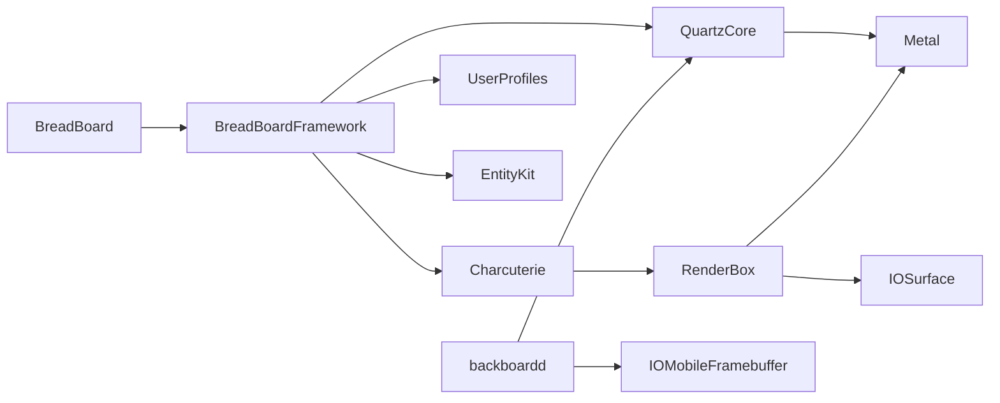

# Userland, Graphics, and Peripheral Findings

Inspection date: 2026-11-01 (Asia/Shanghai). Sample: HomeView 27.2, build `24V514`.

## Scope and extraction

All 47 `AssetData/payloadv2/payload.NNN` members were streamed directly from the encrypted archive through the system decompressor and AppleArchive decoder. The inventory contains 196,583 archive entry records, not necessarily that many unique regular files. Directories and link records are included. No full filesystem image was reconstructed, mounted, or booted.

Two selection passes extracted 720 unique regular files totaling 5,096,849,710 bytes (about 4.75 GiB): shared caches, selected executables, the BreadBoard bundle, launch configurations, and audio-related plists. An 8 GiB aggregate selected-data bound was applied per pass; the combined observed output is also below that bound. No multi-gigabyte decrypted intermediate archive or payload chunk was staged. The inventory and selected-file hash records are under `analysis/userland/`, not `Research/`.

All 720 selected sizes and SHA-256 hashes were independently reread and checked after extraction. All 643 selected plists parsed successfully. Package-wide publisher signature verification and filesystem reconstruction are outside these checks.

## Executable architecture: direct sample evidence

The following are thin little-endian 64-bit Mach-O files, CPU type `0x0100000c`, subtype `0x80000002` (base subtype 2, arm64e). There is no alternative plain-arm64 slice in these particular files.

| Executable | Bytes | SHA-256 |
| --- | ---: | --- |
| `/usr/lib/dyld` | 1,365,120 | `a46db7cc4f690593c96a54e2dc3f156e26ddf4909738a8135eb97b2a6e6754b1` |
| `/sbin/launchd` | 605,024 | `48477fd124ce68e74378c5359c8d9bfd868f0d43f1a4c7175858835d05d540c8` |
| `/System/Library/CoreServices/BreadBoard.app/BreadBoard` | 78,816 | `04d5e1119ddb0c0c2c513a987212eaf70e47d9d686738489203062026f9448c3` |
| `/usr/libexec/backboardd` | 782,640 | `5024da86d768b53a7f104cd8e342aa3fb51e8029e891fced64c1698d87fd3f1e` |
| `/usr/libexec/audiomxd` | 147,840 | `ebe19db79ae9ca2019570074357ac3d707376f99abda3aa5ecaa9ab5924aad61` |
| `/usr/libexec/airplayd` | 90,864 | `375943edee00fb2c58cf2d128ccfd9df206b9bdcf367582845e7cf62d633c178` |

`dyld_info -platform` reports tvOS minimum 27.2 / SDK 27.2 for dyld, launchd, and BreadBoard. Separately inspected userprofilesd, VirtualAudio, PiperPlugin, and PapagaioPlugin are also arm64e. This supersedes any inference that a donor device-tree architecture string makes the whole system plain arm64.

## PAC is actually used

The installed LLVM disassembler decoded PAC-related instructions in all six executables above. These are static mnemonic counts in the decoded text, not execution frequencies or a complete control-flow audit:

| Executable | `pacibsp` | `retab` | `blraa` | `pacda` |
| --- | ---: | ---: | ---: | ---: |
| dyld | 2,054 | 1,570 | 556 | 471 |
| launchd | 1,188 | 951 | 58 | 154 |
| BreadBoard | 5 | 5 | 0 | 0 |
| backboardd | 1,306 | 777 | 72 | 320 |
| audiomxd | 50 | 33 | 16 | 32 |
| airplayd | 1 | 1 | 0 | 0 |

Other observed mnemonics include `autda`, `autibsp`, `braa`, and `blraaz`. `dyld_info -fixup_chains` recognizes authenticated arm64e fixup formats in all six. For BreadBoard it specifically reports pointer format 12, `DYLD_CHAINED_PTR_ARM64E_USERLAND24`, with a 16 KiB chain page size.

Inference: changing the Mach-O subtype or removing a few prolog instructions is not a demonstrated compatibility solution. Data-pointer authentication, authenticated branches/returns, loader fixups, and ABI behavior must be handled coherently. This does not prove the impossibility of a substantial translator or emulator.

## Shared-cache inspection

The main cache directory contains 57 selected files, including symbols and atlas auxiliaries. The mapping/image inspection used 55 cache files excluding those two auxiliary files, yielding 72 mapping records. The main cache header identifies arm64e. Its text-image table contains 2,904 images; every image header parsed at its mapped address has CPU subtype `0x80000002`.

Image lookup used `dyld_cache_header.imagesTextOffset/imagesTextCount`, image text records, and per-file mapping tables, with file bounds, Mach-O magic, and load-command sizes checked. The layout was consulted in Apple's [dyld_cache_format.h](https://raw.githubusercontent.com/apple-oss-distributions/dyld/main/include/mach-o/dyld_cache_format.h) on 2026-11-01. This validates the parsed image/header relationships, not every fixup or every mapped page.

The inspected frameworks include BreadBoardFramework, BreadBoardFoundation, BackBoardServices, QuartzCore, Metal, IOSurface, IOGPU, RenderBox, EntityKit, UserProfiles, AudioToolbox, and CoreAudio. Each has arm64e headers and `__AUTH` / `__AUTH_CONST` segments. Segment names alone are not a count of authenticated pointers.

The local `.48` cache file's SHA-256 is `e1b3a717e9e93b81f6542aa7ee11ded01a0e83b5c91fa8b65ba7bc67ee87dd67`, matching the value reported for that chunk in the pinned reference research. This corroborates one chunk, not all reference binaries or transformations.

## Graphics and desktop import relationships

The BreadBoard executable imports BreadBoardFoundation, BreadBoardFramework, Foundation, libobjc, and libSystem. BreadBoardFramework has 96 recorded load-library commands. Parsed dependency paths include:

These are import relationships, not an observed runtime call sequence or proof that every imported library is needed for every screen. The import-closure traversal is recorded under `analysis/userland/audit/breadboard-import-closure.json`; weak and re-exported relationships were included and should not all be treated as unconditional runtime requirements.

The evidence supports investigating a Metal/IOSurface/display-server compatibility path. A simple HDMI framebuffer has not been shown to satisfy it. IOGPU is present in the cache, but no runtime requirement on a particular IOGPU driver was established here.

## Services and entitlements

The actual launch configuration declares BreadBoard as a persistent mobile-user app. backboardd advertises display, CARenderServer, and HID endpoints. userprofilesd resides at `/System/Library/PrivateFrameworks/UserProfilesDaemon.framework/Support/userprofilesd`, not `/usr/libexec/userprofilesd`.

BreadBoard's embedded entitlements contain 136 keys and select `temporary-sandbox`. The explicit global Mach-lookup exception list contains `com.apple.userprofiles` and `com.apple.mobile.keybagd.UserManager.xpc`, but omits:

- `com.apple.backboard.display.services`;
- `com.apple.CARenderServer`;
- `com.apple.MTLCompilerService`.

userprofilesd also selects `temporary-sandbox`, and its explicit exception list omits `com.apple.mobile.keybagd.UserManager.xpc`.

These local observations match specific reference-project repair hypotheses. They are not locally observed denials: a complete sandbox policy can grant access through other rules, and behavior depends on the selected kernel/runtime. No entitlement edits, sandbox bypasses, re-signing, or patches were applied.

## Networking and USB reuse opportunities

The original kernel fileset has 236 entries. Its prelink metadata contains 248 kext records; metadata records are not necessarily independently executable fileset entries or loaded drivers.

Local fileset and personality inspection found:

| Component | Matching evidence | What remains unproved |
| --- | --- | --- |
| AppleUSBAudio | 10 personalities, including audio-control class 1 / subclass 1 on IOUSBHostInterface | Actual device matching, stream formats, host-controller operation, audio routing |
| USB CDC ECM | Control class 2 / subclass 6; data class 10 personalities | Usable Ethernet interface on a selected device/runtime |
| USB CDC NCM | Control class 2 / subclass 13 and data personalities | Same, including endpoint/transfer behavior |
| USB ASIX | 18 vendor/product-specific personalities | Support for an arbitrary adapter or hardware revision |
| IOHIDFamily | HID event/interface personalities | Correct USB touch transport and multitouch delivery |

This strengthens the case for investigating standard USB-class peripherals. It does not eliminate the CPU, USB host, power, DMA/IOMMU, interrupt, ABI, or service-integration work. An adapter's marketing label is not sufficient; compare actual descriptors or VID/PID with the selected driver personality.

configd's launch configuration advertises DNS, IP configuration, and SystemConfiguration services. wifid advertises CoreWiFi endpoints. A connected interface is only the first networking checkpoint; DNS, HTTPS, time, and each product service still need runtime tests.

## Audio and microphone architecture

The original kernel includes AppleUSBAudio, AppleARMIISAudio, AppleEmbeddedAudio, AOPAudio2, IOAudio2Family, IOTimeSyncFamily, IOgPTPPlugin, ExclavesAudioKext, and isolated-stream proxy components. Their presence does not prove that every route uses all of them.

The actual audio daemon is audiomxd, importing MediaToolbox, MediaExperience, AudioToolbox, CoreMotion, and other libraries. Its launch plist advertises AudioSession, AudioUnitServer, AudioComponentRegistrar, AURemoteIOServer, driver-registration, voice-trigger, and routing services. Several AirPlay endpoints are conditionally owned by audiomxd or airplayd through feature-flag dictionaries. Static plist inspection cannot determine which condition is active at runtime.

The selected audio plug-ins are arm64e:

- VirtualAudio links TimeSync, AudioDSPGraph, CiderAudioServer, CoreMotion, and other frameworks. Its name does not establish generic hardware-virtualization support.
- PapagaioPlugin links PapagaioAudio, AudioServerApplication, AudioServerDriver, AudioToolbox, and CoreAudio.

A USB class driver is therefore a possible lower layer, not the complete output/input solution. The ordered runtime tests remain: enumerate device; open streams; play known PCM; capture known input; run full duplex; check timestamps/dropouts; assess echo cancellation; only then test product voice services.

## Remaining limits

No original userland executable was launched. No device, GPU, audio route, network, pairing, Siri, or HomeKit feature was tested. Cached frameworks were inspected in place; no fully reconstructed standalone framework suitable for arbitrary analysis tools was produced. The current results are sufficient to identify first-order blockers and plan controlled experiments, not to claim runtime functionality.

## Complete-tree follow-up

The complete main content tree has since been expanded and verified on the external volume. See [Complete extraction](FULL_EXTRACTION.md). A full standalone-file header survey found one plain-ARM64 STExtractionService executable, but no alternative plain-ARM64 dyld/launchd/BreadBoard in the inspected startup paths. The main-cache image architecture result remains unchanged.

The full tree confirms a usbaudiod launch service, a separate acoustic-calibration daemon, usermanagerd's backend endpoint declaration, a Metal.framework MTLCompilerService XPC bundle, and an AGXMetalG17P bundle. These are local static observations, not runtime tests. The cached BreadBoardFramework/BackBoardServices binaries are not ordinary standalone files at their framework paths, even after full content expansion.
